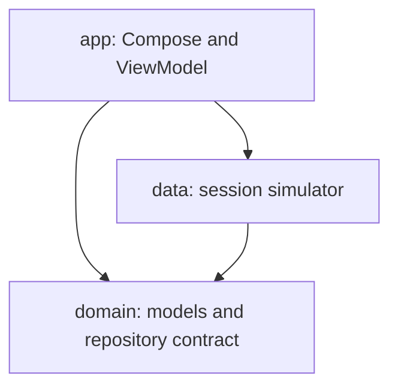

# Breda Wallet

A fictional Android wallet portfolio project by Bruno Breda. Kotlin, Jetpack Compose and a testable transfer ledger.

## First increment
- Balance, transaction history and simulated transfers with a Portuguese UI.
- Plain Kotlin domain and data modules; Compose UI with lifecycle-aware state collection and ViewModel.
- Integer BRL cents, serialized ledger updates and repository-level idempotency.
- Tests covering duplicate requests, insufficient funds, conflicting IDs and concurrent debits.
- GitHub Actions configuration for JVM tests, Android lint and a debug APK artifact.

## Run
Requires JDK 17, Android SDK 35 and Gradle 8.11.1. Open this directory in Android Studio. This archive does not include the binary Gradle wrapper; generate it with an installed Gradle:

```sh
gradle wrapper --gradle-version 8.11.1
./gradlew :domain:test :data:test :app:lintDebug :app:assembleDebug
```

On Windows use `gradlew.bat`. Install the debug APK or run the app on an API 26+ emulator/device. Start with R$ 2.500,00, enter a fictional recipient and transfer 25,50; balance becomes R$ 2.474,50 and history receives one entry. Relaunching after process termination resets the ledger.

## Architecture


Manual dependency wiring keeps this increment small. Hilt and separate feature modules can follow when the object graph and feature boundaries justify them. See [ADR 0001](docs/adr/0001-money-and-demo-boundaries.md).

## Roadmap
1. Validate build and behavior on a device; add screenshots and meaningful UI tests.
2. Introduce Room with atomic ledger persistence and process-recreation tests.
3. Add a mock HTTP service and Retrofit, timeout/error handling and stable retry keys.
4. Add BiometricPrompt with explicit session policy and security threat model.
5. Add Hilt, accessibility validation and coverage reporting.

## Validation status
Source files and archive structure inspected. Android compilation, JVM tests and device behavior have **not** been executed in the authoring environment: Android SDK and Gradle are unavailable. The workflow is provided but has not run. Do not advertise this as a finished or production-ready banking application.

## Boundaries
No real payments, credentials, client code, financial data or proprietary APIs. No authentication, persistence, Room, Retrofit or Hilt implemented yet. Versions are pinned for a reproducible starting point, not advertised as the latest releases.
