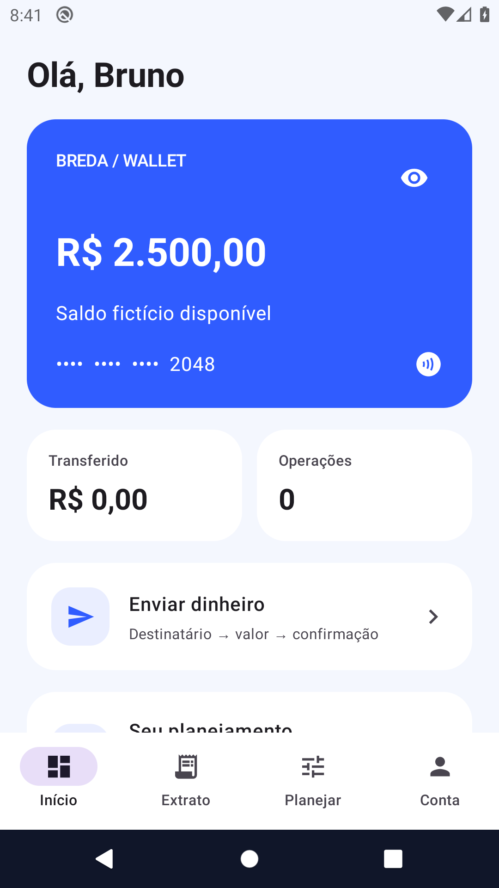
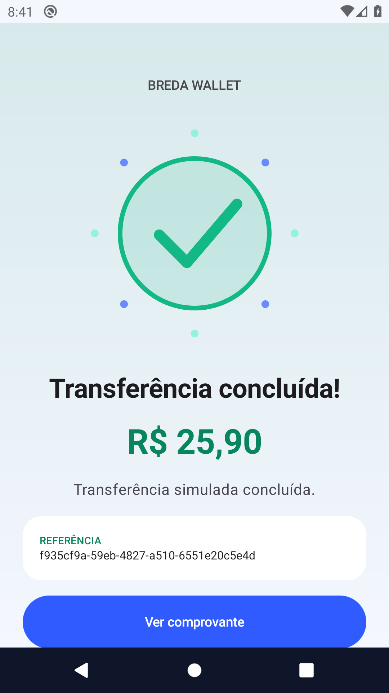

# Breda Wallet

**Carteira digital de demonstração com consistência de saldo e transferências idempotentes.**

Projeto de **Bruno Breda · breda_dev**. Explorar uma jornada de carteira digital e demonstrar como proteger saldo e histórico diante de repetição de comandos e falhas de persistência.

**Plataforma:** Android nativo · Kotlin · Jetpack Compose  
**Estado:** implementação de portfólio em evolução; esteira aprovada na execução referenciada.

[Fluxos e demonstração](docs/fluxos.md) · [Engenharia](docs/engenharia.md) · [Builds e evidências](docs/evidencias.md) · [Portfólio completo](https://github.com/brunobredadeveloper/breda-park-wash/blob/main/docs/portfolio-breda-dev.md)

## O que você pode avaliar

- Saldo fictício, envio com revisão e comprovante, extrato com busca e planejamento de metas.
- Abertura com Lottie, login/cadastro/recuperação, modo local explícito e telas de processamento, sucesso e erro.
- Ledger e memória de idempotência persistidos atomicamente; concorrência protegida por Mutex.
- Separação dos dados locais por conta e autenticação Firebase opcional.

## Telas reais

Capturas do aplicativo executado em emulador Android, recuperadas dos artefatos da esteira. Não são mockups nem fotografias de um aparelho físico. A origem e os limites estão em [evidências](docs/evidencias.md).




## Fluxo principal

1. Abra o modo de demonstração local pela tela de acesso.
2. Consulte o saldo e abra Enviar dinheiro.
3. Informe um destinatário de teste e um valor em reais; revise e confirme.
4. Confira o resultado e a operação no extrato.
5. Tente um valor inválido ou acima do saldo e confirme a ausência de débito indevido.

## Executar e validar

JDK 17, Android SDK 35 e Android 8+ (API 26). Use o Gradle Wrapper versionado.

```sh
./gradlew :domain:test :data:test :app:testDebugUnitTest :app:lintDebug :app:assembleDebug
```

Configuração, Firebase quando aplicável, assinatura e comandos adicionais: [referência técnica](docs/referencia-tecnica.md).

[Abrir a execução verificada no GitHub Actions](https://github.com/brunobredadeveloper/breda-wallet/actions/runs/38172912981). A conclusão dessa execução é **success**; consulte os artefatos e a revisão de código em [evidências](docs/evidencias.md).

## Limites do produto

Dinheiro fictício; sem conta bancária, Pix real ou integração com adquirente. Hash de UID organiza os arquivos, mas não os criptografa. O ledger de demonstração tem limite de 1.000 requisições, sem descarte de chaves antigas.

## Para quem revisa o portfólio

Recrutadores e equipes mobile que avaliam engenharia de aplicações financeiras. As [decisões de engenharia](docs/engenharia.md) conectam responsabilidades, arquivos e testes. O [roteiro funcional](docs/fluxos.md) ajuda a avaliar comportamento, falhas e preservação de dados. Funcionalidade planejada não é apresentada como implementada.

## Próximos passos

- Validar os percursos no dispositivo real e registrar os resultados.
- Revisar acessibilidade, interrupções e falhas de armazenamento/rede aplicáveis.
- Concluir requisitos de distribuição, suporte e segurança antes de uso comercial.

Código, mídias e dependências mantêm seus respectivos termos. Consulte os créditos e os avisos existentes no repositório.
