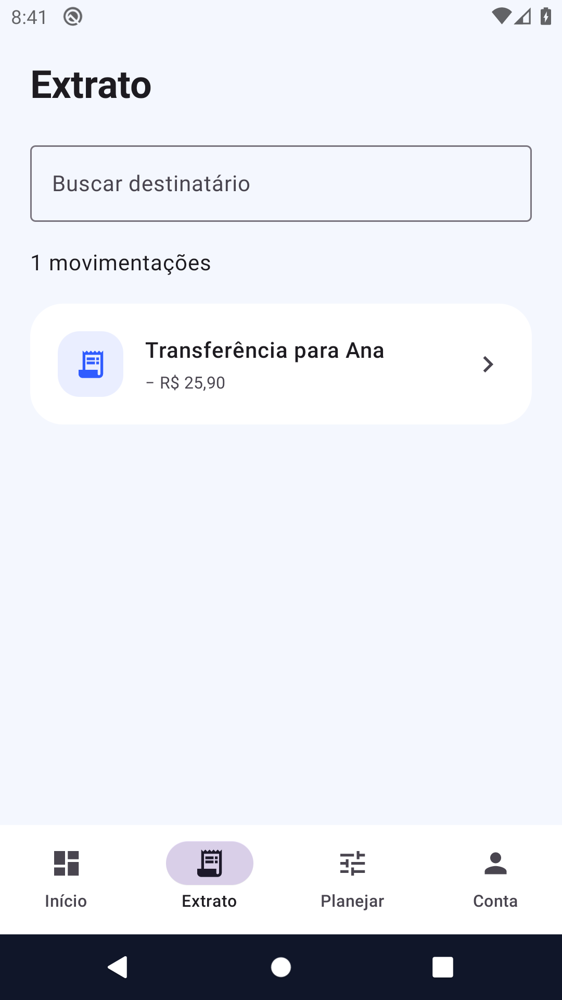

# Fluxos de uso — Breda Wallet

Explorar uma jornada de carteira digital e demonstrar como proteger saldo e histórico diante de repetição de comandos e falhas de persistência.

## Mapa de telas

| Tela / área | O que a pessoa faz | Referência de implementação |
|---|---|---|
| Início | Consultar saldo fictício e atalhos. | [ProductWorkspace.kt](../app/src/main/kotlin/dev/breda/wallet/ProductWorkspace.kt) |
| Enviar | Informar destinatário e valor; revisar antes de confirmar. | [WalletViewModel.kt](../app/src/main/kotlin/dev/breda/wallet/WalletViewModel.kt) |
| Resultado | Acompanhar processamento, comprovante ou orientação de erro. | [Experience.kt](../app/src/main/kotlin/dev/breda/wallet/Experience.kt) |
| Extrato | Buscar operações já registradas. | [ProductWorkspace.kt](../app/src/main/kotlin/dev/breda/wallet/ProductWorkspace.kt) |
| Planejar e conta | Organizar metas locais e gerenciar sessão. | [AccountSession.kt](../app/src/main/kotlin/dev/breda/wallet/AccountSession.kt) |

## Demonstração guiada

Use dados fictícios, em ambiente de avaliação.

1. Abra o modo de demonstração local pela tela de acesso.
2. Consulte o saldo e abra Enviar dinheiro.
3. Informe um destinatário de teste e um valor em reais; revise e confirme.
4. Confira o resultado e a operação no extrato.
5. Tente um valor inválido ou acima do saldo e confirme a ausência de débito indevido.

## Casos que merecem atenção

- Repetição da mesma chave não deve duplicar o débito.
- Falha de gravação não pode publicar novo saldo.
- Planejamento de metas não movimenta dinheiro.

## Escopo e resultado esperado

Dinheiro fictício; sem conta bancária, Pix real ou integração com adquirente. Hash de UID organiza os arquivos, mas não os criptografa. O ledger de demonstração tem limite de 1.000 requisições, sem descarte de chaves antigas.

## Galeria e contexto

As imagens abaixo representam um instante de uma execução automatizada. Uma captura estática não demonstra som, suavidade de animação, latência ou persistência.

### Painel inicial

### Resultado de sucesso

### Histórico

## Checklist para validação do proprietário

- [ ] Instalar/abrir a versão correspondente às evidências.
- [ ] Percorrer a jornada principal e uma condição de falha.
- [ ] Confirmar navegação, retorno, teclado e leitura em tela pequena.
- [ ] Fechar/reabrir e verificar os dados que devem persistir.
- [ ] Avaliar os recursos nativos pertinentes no aparelho real.
- [ ] Registrar versão, aparelho, resultado esperado e observado em eventual relato.

[Voltar ao README](../README.md) · [Evidências](evidencias.md)
